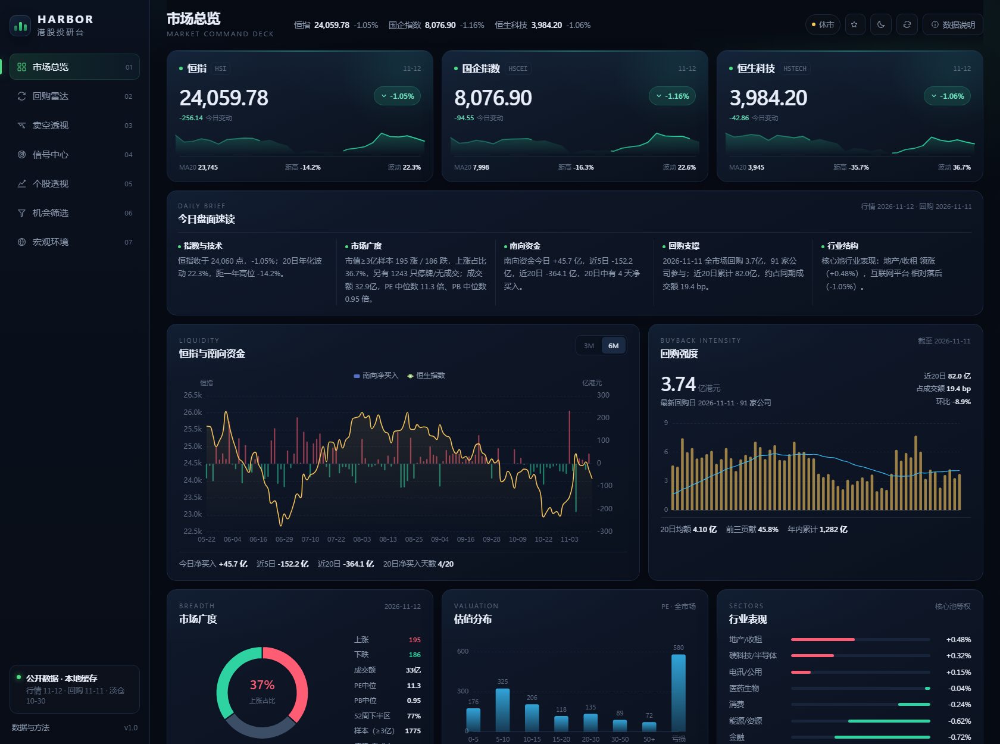
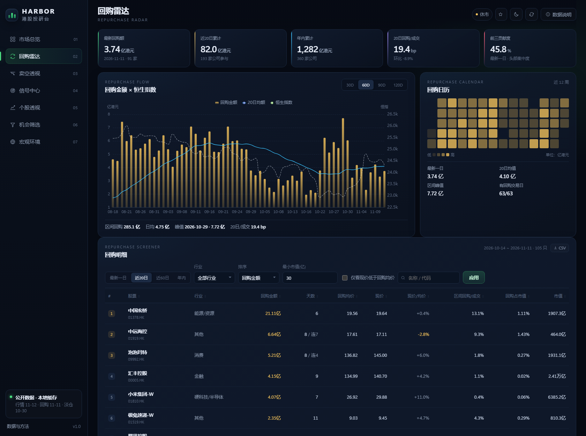
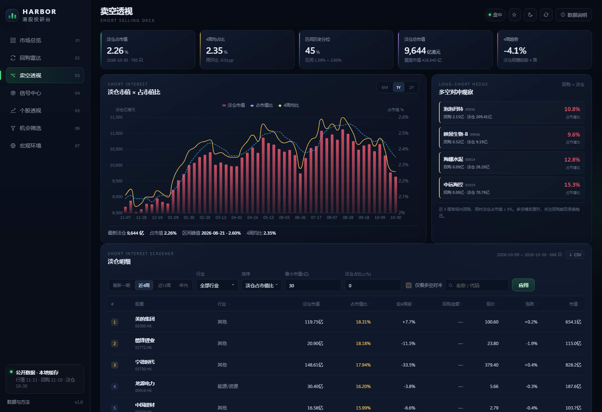
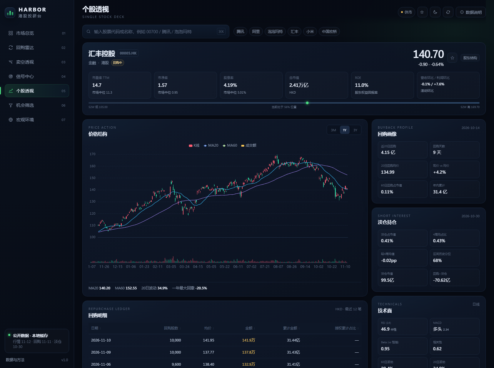
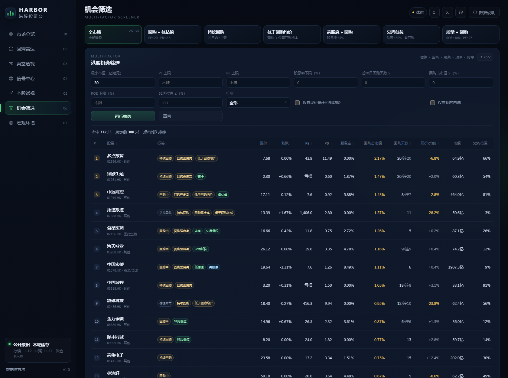
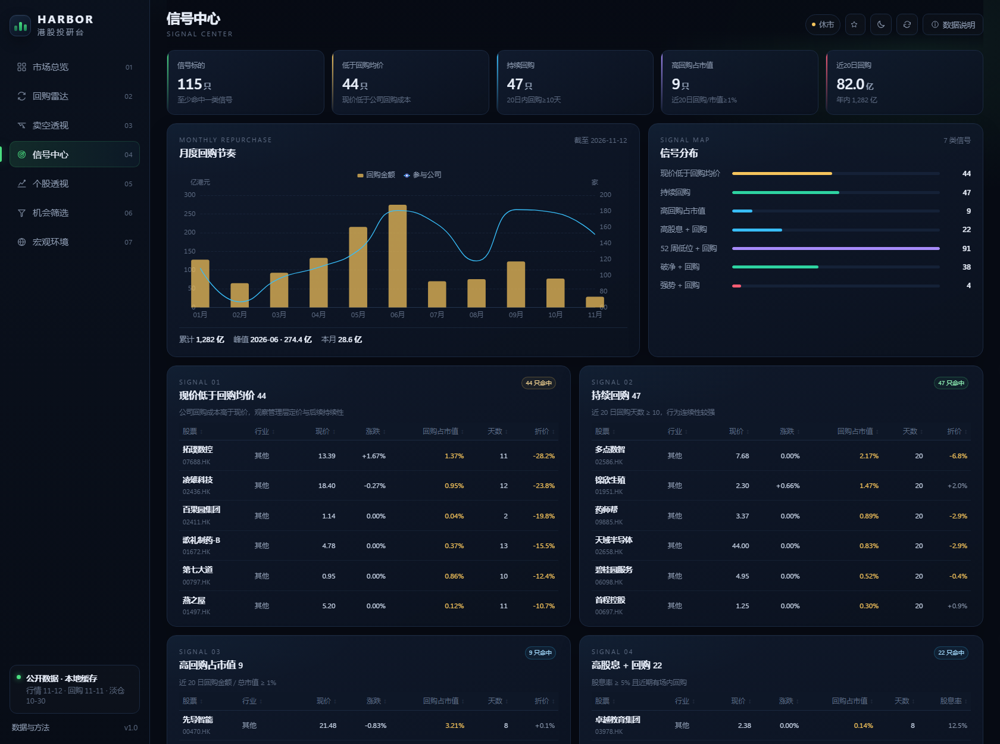
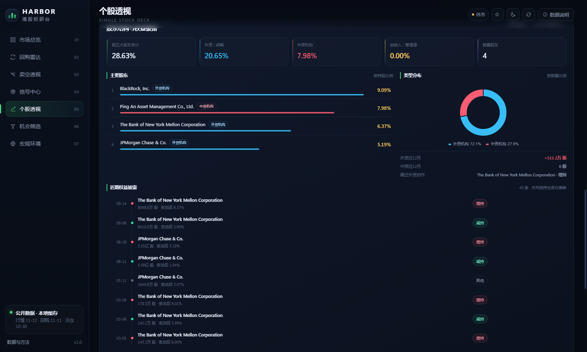
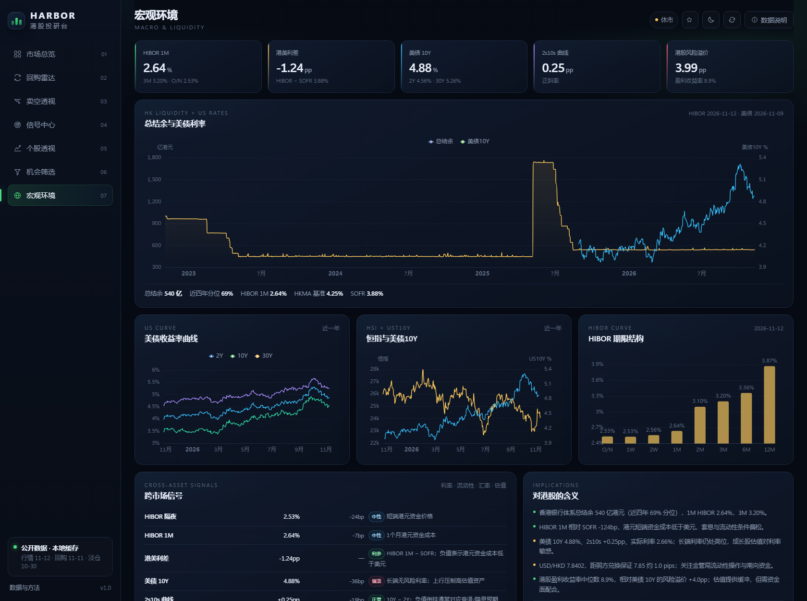
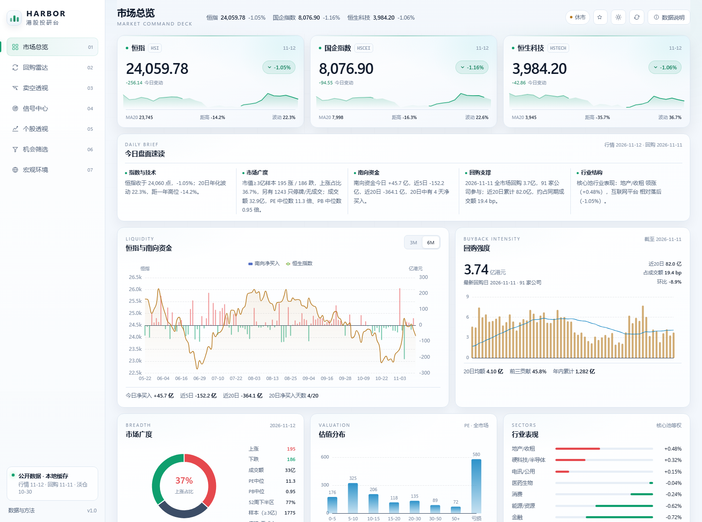

# Harbor · 港股投研台

一个面向港股市场的本地投研面板：把 **港交所官方回购披露、全市场行情、估值分布、南向资金、行业表现、个股财务与回购成本** 放在同一个界面里。

> 数据来自公开渠道，仅供研究辅助，不构成投资建议。
>
> 设计上借鉴 Bloomberg / Wind 的跨资产监控框架：把**估值、回购、南向资金、港元流动性、美债利率、汇率与 5%+ 股东行为**放在同一个研究流程里；股东分析参考 Futu 的 CCASS/权益披露思路，但不使用其闭源数据。



## 为什么做这个

现有方案各有缺口，因此本项目采用「官方数据源 + 轻量自建前端」的组合：

| 方案 | 能力 | 结论 |
|---|---|---|
| [AKShare](https://github.com/akfamily/akshare) | Apache-2.0，港股行情/财务/南向资金接口丰富 | **已复用**。用于财务指标、南向资金历史；但其港股接口中没有回购数据 |
| [OpenBB](https://github.com/OpenBB-finance/OpenBB) | 成熟投研平台，资产类别覆盖广 | AGPL-3.0，组件重；无港交所回购连接器。仅参考交互与指标设计，未复用代码 |
| [yfinance](https://github.com/ranaroussi/yfinance) | 港股日线/报价方便 | 无回购数据；行情延迟与限流不可控，未启用 |
| [Futu OpenAPI](https://github.com/FutunnOpen/py-futu-api) | 牛牛 App 的回购页体验最佳，有完整行情 | 需要 OpenD 客户端与开户账户，不适合零门槛本地工具；作为产品形态参考 |
| [港交所 Share Repurchase Reports](https://www3.hkexnews.hk/reports/sharerepur/sbn.asp) | 每日全市场回购 XLS，权威、免费 | **本项目核心数据源**，直接下载解析 |
| [SFC 淡仓申报汇总](https://www.sfc.hk/en/Regulatory-functions/Market/Short-position-reporting/Aggregated-reportable-short-positions-of-specified-shares) | 每周全市场申报淡仓 CSV（股数 + 港元市值），2014 年起 | **卖空数据源**。港交所每日卖空成交页受 WAF 拦截，改用证监会官方周度淡仓持仓 |
| Streamlit / Dash | 快速搭数据应用 | 自定义视觉与交互受限，最终采用 Flask + 原生 JS + ECharts |

结论：**AKShare 解决财务/资金，港交所解决回购，SFC 解决淡仓持仓，腾讯公开行情解决全市场快照；前端用 ECharts 自建，避免引入重型平台。**

## 功能

### 01 市场总览
- 恒指 / 国企指数 / 恒生科技，30 日走势与均线、回撤
- 恒指 × 南向资金、回购金额 × 恒指、市场广度、PE 分布、行业表现
- 自动生成“今日盘面速读”
- 最新回购榜、涨幅/跌幅/成交异动

### 02 回购雷达
- 最新一日 / 近 20 日 / 近 60 日 / 年内回购榜
- 回购金额、回购均价、现价相对回购均价的溢价/折价
- 回购占市值、回购占成交额、连续回购天数
- 12 周回购日历热力图
- 可按行业、最小市值、是否低于回购均价筛选



### 03 卖空透视
- SFC 每周「指定股份合计须申报淡仓」官方数据，覆盖全市场可卖空标的
- 市场淡仓总市值 × 占市值比走势，叠加恒指与 4 周均值
- 个股淡仓排名：淡仓市值、占市值比、较期初变化，支持行业/市值/占比筛选
- **多空对冲观察**：公司回购同时淡仓占比偏高的标的，回购能否承接抛压
- 个股页内置「淡仓持仓」卡片：占市值比、4 周均值、历史分位、回购−淡仓净额



### 04 个股透视
- 搜索任意港股，展示 3 年 K 线、MA20/60、成交额
- **回购足迹直接标注在 K 线上**（点大小 = 当日回购金额）
- PE/PB/股息率/市值/ROE/营收与利润环比
- 52 周位置、一年最大回撤、波动率
- 回购画像、淡仓持仓、技术面、投研结论、回购明细、同业对比



### 05 机会筛选
- 7 个预设策略：全市场、回购+低估值、持续回购、现价低于回购均价、高股息+回购、52 周低位+回购、质量+回购
- 多维过滤：市值、PE、PB、股息率、回购天数、回购占市值、ROE、52 周位置、行业
- 输出估值、回购、股息与动量指标及标签，列头可点击排序



### 06 信号中心
- 7 类可执行信号：现价低于回购均价、持续回购、高回购占市值、高股息+回购、52周低位+回购、破净+回购、强势+回购
- 月度回购节奏：2026 年逐月回购金额与参与公司数
- 信号分布与命中数量，一键跳转个股透视



### 07 股东结构与权益披露
- 指标条：前五大合计、外资/战略、中资机构、创始人/管理层、披露股东数
- 主要股东：按类型着色的持股占比条 + 类型标签；右侧类型分布圆环
- 资金动向：外资/中资近 12 个月净增减、最近一笔外资动作
- 近期权益披露：时间线呈现增减持（日期、变动股数、变动后比例、方向）
- 数据来自 HKEX DION 权益披露，按名称规则分类，明确标注覆盖范围与局限



### 08 宏观与流动性
- 香港：银行体系总结余、HIBOR 隔夜/1M/3M 至 12M 期限结构、HKMA 基准利率、兑换保证
- 美国：2Y/10Y/30Y 美债、2s10s 曲线、TIPS 实际利率、SOFR、VIX
- 汇率与估值：USD/HKD、USD/CNY、港股盈利收益率相对美债 10Y 的风险溢价
- “对港股的含义”自动解读
- 数据：HKMA、HKAB、FRED，支持亮色/暗色图表



### 主题与效率工具
- **亮色 / 暗色主题**：右上角一键切换，图表、表格、弹层同步换色，偏好保存在本地
- **自选股**：个股页星标加入，顶部星标抽屉查看自选行情，筛选器支持“仅看我的自选”
- **技术面**：RSI(14)、MACD、Beta、与恒指相关性、20/60日年化波动
- **列头排序**：回购、卖空、筛选、信号、股东与个股表格均支持点击列头升/降序
- **动效**：指数卡数字滚动、曲线绘制、卡片入场与悬浮光影；遵循系统“减少动态效果”设置
- **CSV 导出**：回购明细、筛选结果一键导出（UTF-8 BOM，Excel 可直接打开）



## 快速开始

要求：Python 3.10+（当前开发环境为 3.13）。

```bash
cd D:\code\hk
pip install -r requirements.txt
python app.py
```

打开 <http://127.0.0.1:8767>。

Windows 也可以直接双击 `run.bat`。如果系统的 `python` 指向 Microsoft Store 别名，请使用 `py -3 app.py`。

首次启动且数据库为空时，页面会进入初始化流程，自动同步：

1. 港交所证券名录
2. 2026 年以来全部每日回购报告（约 217 份 XLS）
3. 全市场约 2,800 只港股快照
4. SFC 近一年每周淡仓持仓报告
5. 恒指系列 K 线、南向资金
6. 核心池与主要回购标的的财务、日 K

首次同步约 3–6 分钟；之后点击右上角刷新，只补缺失报告与最新行情。

### 配置

| 环境变量 | 默认 | 说明 |
|---|---|---|
| `HK_PORT` | `8767` | Web 端口 |
| `HK_BUYBACK_START` | `2026-01-01` | 回购采集起始日 |
| `HK_SHORT_START` | `2025-06-01` | SFC 淡仓持仓采集起始日 |

手动重建回购缓存：

```bash
python sync.py --buybacks-only --force-buybacks
```

## 数据口径

### 回购
- 来源：港交所每日 `SRRPTYYYYMMDD.xls`，页面按报告日发布，报告内同时包含前一交易日成交与少量补录。
- 市场总量：`Method = Exchange` 且 `Currency = HKD`，按 **trade_date** 去重后汇总；同一公司同日不同交易所/币种分别保留。
- 最新回购日通常比行情晚一个交易日。例如 11 月 2 日盘中，最新可见回购日为 10 月 30 日。
- 回购金额/成交额为估算：`日K成交量 × 收盘价` 近似成交额，用于横向比较；与券商终端的精确成交额可能有小幅差异。
- 对金额与股数/价格明显矛盾的披露（成交均价超出当日最低/最高价 ±20%）自动标记为异常并剔除出市场统计；若金额填的是累计口径但能通过累计股数验证，则按当日股数折算。
- 统一把 `Exchange`、`Exchange (Note 1/2/3...)` 视为港交所场内回购；同一股票同日出现更正披露时，以较新报告为准。
- 2026-10-29 实测：复星医药回购占成交 30.09%（牛牛截图 29.94%）、泡泡玛特 14.51%（截图 14.46%），口径基本一致。
- 截至 2026-10-30，2026 年内有效场内回购约 **1,252 亿港元**（剔除异常金额后）。

### 股东与权益披露
- 来源：HKEX Disclosure of Interests（DION）中 5%+ 大股东及董事披露。
- “前五大股东”采用**合并口径**，避免同一经济利益的重复实体重复计算。
- 增减持方向按同一股东前后持仓变化推断；首次披露结合事件代码（100x 购入、120x 出售）。
- 股东类型按名称关键词推断，可能存在误分类；不等同于基金季报/13F 的全部持仓。

### 宏观与流动性
- 香港总结余、HIBOR 曲线、基准利率与兑换保证来自 HKMA/HKAB 公开页面。
- 美债 2Y/10Y/30Y、TIPS 实际利率、SOFR、VIX、USD/HKD 来自 FRED。
- 港股风险溢价 = 港股盈利收益率中位数（1/PE）− 美债 10Y，不是恒指官方盈利收益率。

### 行情与估值
- 腾讯财经公开行情：现价、涨跌、成交额、总市值、PE、PB、股息率、52 周高低。
- 全市场广度与 PE/PB 中位数仅统计 `市值 ≥ 3 亿港元`、PE 在 `(0, 100]`、PB 在 `(0, 20]` 的样本，避免极端值污染；因此“全市场”样本约为 1,780 只，而非全部 2,794 只。
- `PE = 0` 视为行情源无有效估值（常见于停牌/无成交），界面显示“—”；`PE < 0` 才显示“亏损”。
- 52 周高低价与现价明显不一致（现价超出区间 ±10%）时，不参与 52 周位置统计。
- 财务指标来自 AKShare 的东方财富港股财务接口，覆盖核心池 + 主要回购标的（约 200 只）；未覆盖标的在筛选器中按缺失值处理。

### 指标公式
- **回购占市值** = 区间回购金额 ÷ 当前总市值（不年化，避免短窗口失真）
- **现价 / 回购均价** = 现价 ÷ 区间加权平均回购价 − 1；负值表示现价低于公司回购成本
- **52 周位置** = (现价 − 52 周低) ÷ (52 周高 − 52 周低)，并做合理性校验，异常值不参与统计
- **RSI(14)**：Wilder 平滑；≥70 超买、≤30 超卖
- **MACD**：12/26/9 日 EMA，DIF > DEA 为多头
- **Beta / 相关性**：个股与恒指近 250 个交易日对数收益回归
- **信号中心**：基于近 20 日回购、现价/回购均价、股息率、52 周位置与 PB 生成 7 类信号，仅作为筛选起点

## API

| 方法 | 路径 | 说明 |
|---|---|---|
| GET | `/api/meta` | 数据日期、同步状态、数据源、开源致谢 |
| GET | `/api/overview` | 市场总览聚合 |
| GET | `/api/buybacks?period=20&sort=amount` | 回购榜、市场序列、日历 |
| GET | `/api/buybacks/<code>` | 单只股票回购历史与统计 |
| GET | `/api/stocks/<code>` | 个股行情、财务、K 线、淡仓与结论 |
| GET | `/api/search?q=腾讯` | 代码/中文/英文名称搜索 |
| GET | `/api/screener?preset=buyback_value` | 多因子筛选 |
| GET | `/api/signals` | 7 类回购/估值/股息信号中心 |
| GET | `/api/watchlist?codes=00700,09992` | 自选股批量报价与因子 |
| GET | `/api/stocks/<code>/shareholders` | 5%+ 股东、类型分布与增减持披露 |
| GET | `/api/macro` | 港美利率、HIBOR 曲线、汇率、VIX 与风险溢价 |
| GET | `/api/sync/status` | 同步进度 |
| POST | `/api/sync` | 触发后台同步 |

## 项目结构

```
hk/
├── app.py                 # Flask 入口与 REST API
├── config.py              # 核心池、数据源、常量
├── db.py                  # SQLite schema 与连接
├── sync.py                # 同步编排 / CLI
├── ingest/
│   ├── hkex.py            # 港交所回购 XLS 下载、解析、去重
│   ├── tencent.py         # 腾讯报价、批量快照、日 K
│   ├── universe.py        # 港交所证券名录
│   ├── finance.py         # akshare 财务/行业
│   ├── shareholders.py    # HKEX 权益披露抓取、分类与缓存
│   ├── macro_market.py    # HKMA/HKAB/FRED 宏观数据
│   └── macro.py           # 南向资金
├── analytics/
│   ├── market.py          # 指数、广度、估值、行业、市场状态
│   ├── buyback.py         # 回购序列、榜单、日历、个股统计
│   ├── screener.py        # 多因子筛选与预设
│   ├── signals.py         # 信号中心分类聚合
│   ├── shortsell.py       # SFC 淡仓持仓聚合与多空对冲
│   ├── macro.py           # 港美利差、流动性与跨资产信号
│   └── stock.py           # 个股详情、技术指标与结论
├── static/                # 无构建前端（ECharts 本地化）
├── data/
│   ├── hk.db              # SQLite 缓存（可直接使用）
│   ├── raw/               # 已下载的 SRRPT*.xls
│   └── ListOfSecurities.xlsx
└── docs/                  # 截图
```

## 已知限制

- 腾讯行情为公开接口，非交易所 Level-2，盘中可能延迟；批量快照不含历史成交额，回购/成交比例为估算。
- 当前网络环境无法访问东方财富 `push2` 批量行情，因此全市场估值来自腾讯单次快照；AKShare 的财务接口仍可正常使用。
- 港股财报口径差异大，PE/PB 对亏损、一次性收益、不同币种敏感。
- 回购披露存在滞后与补录；最新一日数据可能不完整。
- 核心池行业分类为人工维护，非官方恒生行业分类；非核心标的的行业显示为“其他”。

## 免责声明

本工具仅用于研究辅助，不构成任何投资建议。数据可能存在延迟、缺失或错误，交易前请以港交所披露易与券商终端为准。
